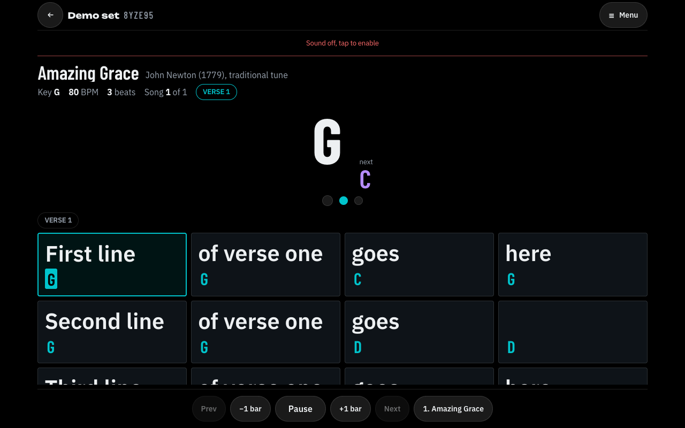
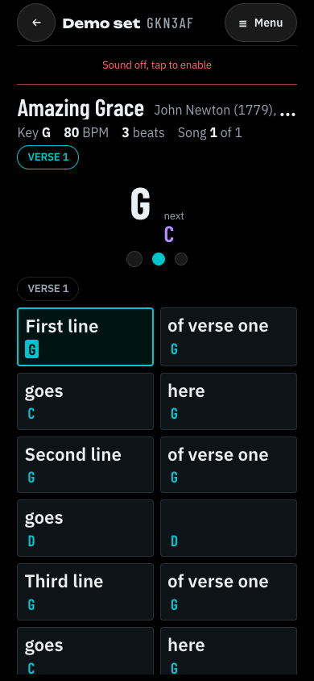
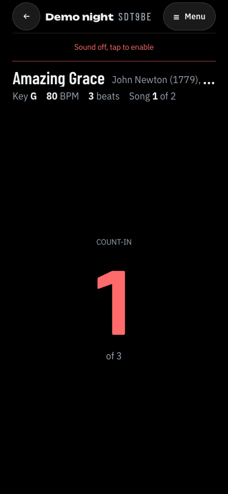
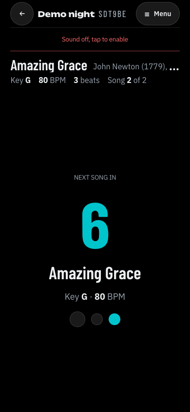
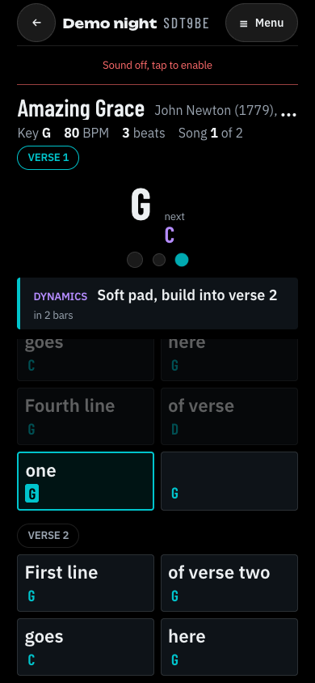
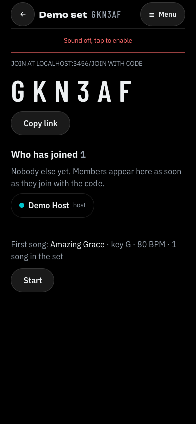
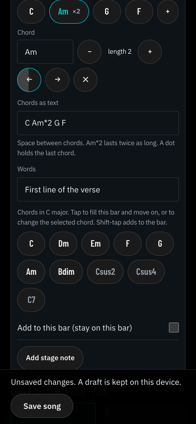
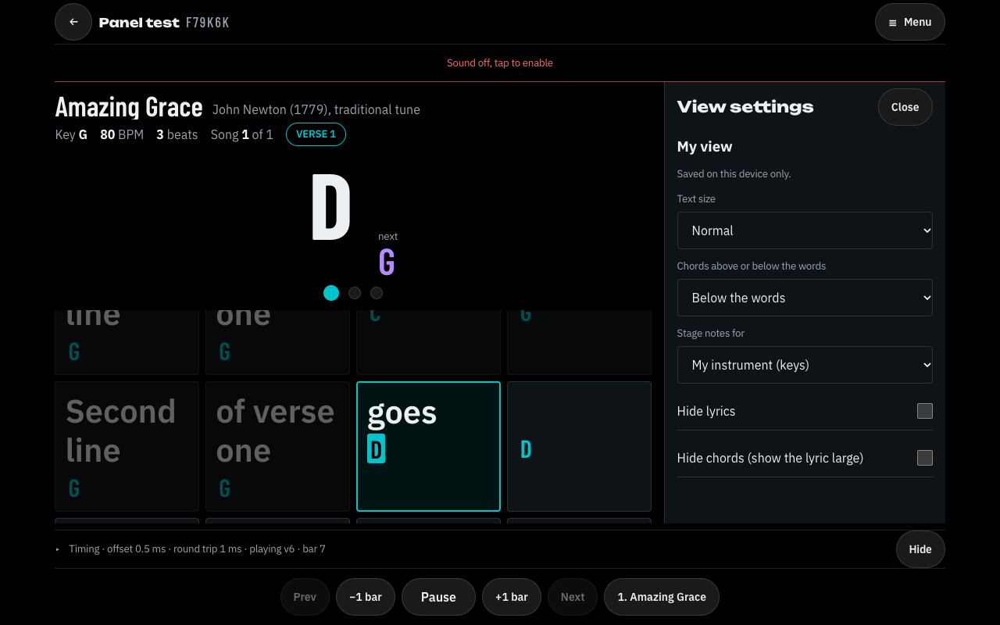
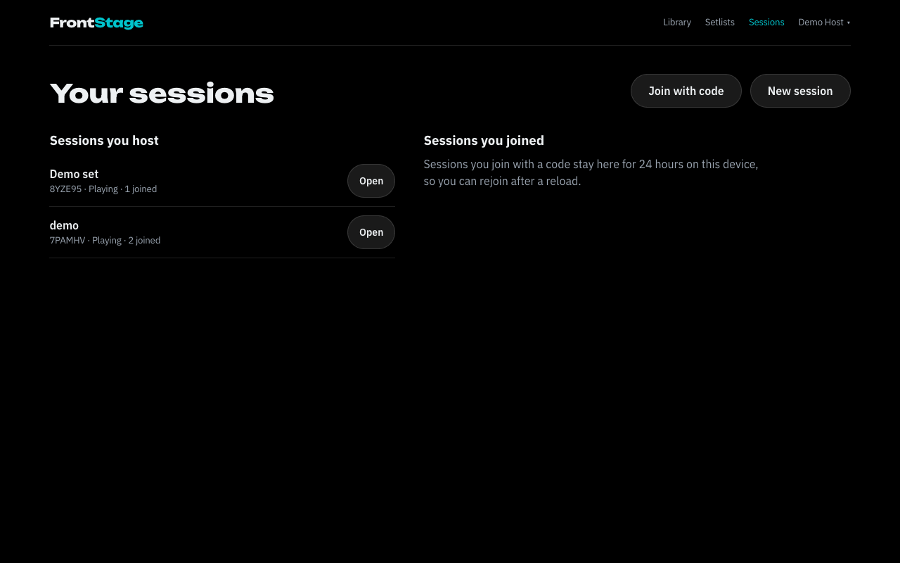

# FrontStage

A web app for bands. The host builds a setlist, starts a live session and shares a 6 character code. Every phone, tablet and laptop that joins plays along like a video: the current song, the BPM, the chord of the moment, lyrics, stage notes for your instrument, a count-in, and a countdown to the next song.



## The problem it solves

In a rehearsal or a gig, each musician keeps their own chart, scrolls it by hand and loses the place, and nobody knows exactly when the next song starts or in which key. FrontStage keeps every device on the same bar without streaming anything: the server stores one anchor ("song N started at server time T"), every device syncs its clock to the server and works out the position itself.

| Phone: song | Phone: count-in | Phone: gap countdown | Phone: stage note | Phone: host lobby |
|---|---|---|---|---|
|  |  |  |  |  |

| Editor: chords in a bar | Laptop: side panel | Your sessions |
|---|---|---|
|  |  |  |

## Features

- One login for everything: a logged-in host gets host controls in their own sessions and stays logged in when joining someone else's. Members need no account. Your sessions lists the sessions you host and the ones you joined (24 hours), with Rejoin.
- Song editor with a tap-to-edit bar grid, any number of chords per bar (chips with length, move and remove, or `Am*2 G F` as text), a chord palette for the song's key, loop fill, paste lyrics, a structure builder and templates. The chart text format (one bar per line, `C G / lyric`, `# Chorus bpm=100 ts=3`) is still there under "Edit as text". Select a bar to add a stage note for some instruments.
- Record mode in the song editor: play a MIDI keyboard (Chrome or Edge) or the on-screen keyboard, hear a sampled piano at once, record with a count-in and click, and get the chord sheet from your playing. Notes are quantized one by one like Logic (1/4, 1/8, 1/16, triplets or auto, with strength and length snap, and you can change it again later). Chords are found at their true beat, with slash chords from the bass, and shown in a preview before Apply writes and saves them. Play back the take, see the chord you hold, and learn any key or button for Record, Stop, Play and Undo.
- Library with search, sort by recently edited and duplicate. Unsaved song changes are guarded and kept as a draft.
- Setlists with per-song transpose, tempo %, count-in, gap mode (countdown, immediate, manual), gap seconds, a running time and Start session, which opens the lobby (big code, copy link, who joined, Start).
- Sessions with a join code, optional password (bcrypt, 5 wrong tries per 10 minutes), participant limit, lock, late join switch, controller policy, kick.
- Live view: big current chord and next chord, beat dots, lyric chart with each bar's words large and its chords underneath, the current bar and chord lit, stage notes with lead-in for your instrument, next-up card, count-in and gap countdown overlays, controls for the host and controllers, a back arrow and a menu (leave, home, sound, view settings, session info, band, session settings, timing details, end session). Panels open as a bottom sheet on phones and a side panel on laptops, and never cover the current bar or the host controls.
- Sound on each device after one tap: a metronome click scheduled with Web Audio from the same timeline, and spoken cues (next song, 3-2-1, sections, tempo changes, your stage notes, last chorus and ending) with Minimal, Standard and Full presets.

## Stack

MongoDB (Mongoose), Express 5, React 19 with Vite and Tailwind 4, Socket.io, Node.js. Plain JavaScript, no TypeScript. Tests with Vitest and `mongodb-memory-server`. One Render web service serves the API, the sockets and the built React app. See [SPEC.md](SPEC.md) for the design and [docs/EXPLAIN.md](docs/EXPLAIN.md) for a walk through every file.

## Run it locally

Needs Node 20 or newer. No database account needed.

```
npm install
npm run seed      # demo host demo@frontstage.test / demo1234, two songs, one setlist
npm run build
npm start         # http://localhost:3000
```

Without `MONGODB_URI`, the server starts a local MongoDB with `mongodb-memory-server` and keeps its data in `.data/mongo` (the first run downloads MongoDB, about 100 MB). Copy `.env.example` to `.env` to set `MONGODB_URI`, `JWT_SECRET` or `PORT`.

For development with live reload of the client: `npm run dev` (Express on 3000, Vite on 5173 with a proxy for `/api` and `/socket.io`).

Tests: `npm test`.

To try a session: log in as the demo host, open **New session**, pick "Demo set", then open the session code on another device or browser window through **Join with code** and press **Start**.

## Deploy

Step by step for MongoDB Atlas and Render in [DEPLOY.md](DEPLOY.md). In short: an Atlas free cluster, a Render web service with build command `npm install --omit=dev && npm run build`, start command `npm start`, and the environment variables `MONGODB_URI` and `JWT_SECRET`.

## Honest limits

- No audio chord detection: charts are typed, or played in on a MIDI or on-screen keyboard in record mode. Record mode keeps one tempo and time signature per take, and its chord detection is a heuristic that has not been tested on real players yet.
- Web MIDI works in Chrome and Edge only. Safari and Firefox get the on-screen keyboard.
- Lyrics are user-entered. The demo uses only public domain songs.
- Sync accuracy is not claimed. Measure it with the debug overlay on two real devices.
- One server instance: rooms and presence live in memory.
- The free Render tier sleeps after 15 minutes without traffic and takes about a minute to wake.

## Fonts

Accent text uses Insidia if you place `insidia.woff2` (or `.woff`, `.otf`, `.ttf`) in `client/public/fonts/` and rebuild. Without it the app uses Unbounded from Google Fonts. Chords and numbers use Barlow Condensed, everything else IBM Plex Sans.

## Piano sound

Record mode plays the Salamander Grand Piano V3 by Alexander Holm, licensed under [CC BY 3.0](https://creativecommons.org/licenses/by/3.0/), in the MP3 form published with Tone.js. The 29 samples live in `client/public/piano/` and load only when record mode opens. See `client/public/piano/CREDITS.txt`.
